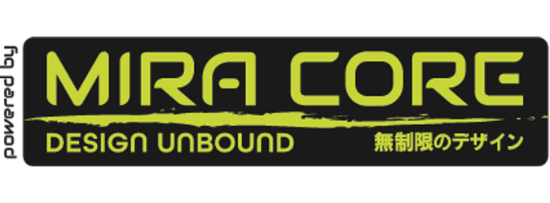

<h1 align="center">Paulo Brigido Filho</h1>

  <strong>Full-Stack Developer</strong> 
  Papamoa Beach, Tauranga, New Zealand · NZ Permanent Resident

  <a href="https://www.orbisrelics.co.nz">orbisrelics.co.nz</a> ·
  <a href="https://www.instagram.com/orbisrelics">Instagram</a> ·
  <a href="https://racketup.co.nz">racketup.co.nz</a> ·
  <a href="https://www.linkedin.com/in/paulo-brigido-filho-7a7a09109">LinkedIn</a> ·
  <a href="mailto:paulobrigidofilho@gmail.com">paulobrigidofilho@gmail.com</a> ·
  <a href="tel:+64272419943">+64 27 241 9943</a>

  
  &nbsp;&nbsp;
  
  &nbsp;&nbsp;
  

  
  
  
  
  
  

---

I build software for businesses that have to run it themselves: a shop, a dashboard, or a tool the staff can use without calling a developer. History and drawing are old interests of mine, and they are why [Orbis Relics](https://www.orbisrelics.co.nz) exists — historical maps, for sale, with [Mira Core](https://www.orbisrelics.co.nz) as the operator dashboard on the same app. React, Node.js, MySQL, and Docker, covered by a large test suite in GitHub Actions.

> Waste no more time arguing what a good man should be. Be one. — Marcus Aurelius

## Projects

<table>
  <tr>
    <td width="50%" valign="top">
      

        
        &nbsp;
        
      

      
<strong>Orbis Relics · Mira Core</strong>

      
<em>Nov 2025 – present · Tauranga</em>

      
Customer storefront and operator dashboard in one product. <strong>Orbis Relics</strong> sells historical maps and merch. <strong>Mira Core</strong> runs the shop: 11 admin modules on the same React app, Express API, and MySQL database. Stories also live on <a href="https://www.instagram.com/orbisrelics">Instagram</a>.

      
React 18, Vite, Node.js, Express, Sequelize, Stripe, Google and Facebook OAuth, NZ GST, GoSweetSpot, DHL Express, Docker, and Nginx.

      
9,000+ automated tests in GitHub Actions. Entry bundle under 300 kB gzipped. Operator ledger, stock analytics, and branded PDF reports. 280+ Jira tickets across 9 sprints.

      

        <a href="https://www.orbisrelics.co.nz">www.orbisrelics.co.nz</a> ·
        <a href="https://www.instagram.com/orbisrelics">instagram.com/orbisrelics</a>
      

      
<em>Production repository is private.</em>

    </td>
    <td width="50%" valign="top">
      

        
      

      
<strong>Racket Up</strong>

      
<em>Jul 2025 – Oct 2025 · Remote</em>

      
Academy platform for <a href="https://racketup.co.nz">Racket Up Badminton Academy</a>, written for coaches who are not technical. Public site, player portal, and admin portal follow how the team already evaluates players: levels, skills, and scores they can read without a spreadsheet.

      
React, Node.js, Express, MySQL, Sequelize, Auth0, Recharts, and Docker. Charts show progress in the language of a coaching session. Guides and admin accounts were handed to the academy.

      
Lighthouse 91 Performance and 100 Best Practices. 200+ Jira tasks across 5 sprints.

      

        <a href="https://racketup.co.nz">racketup.co.nz</a> ·
        <a href="https://github.com/Mission-Ready/racket-up-app">github.com/Mission-Ready/racket-up-app</a>
      

      
<em>Public repository.</em>

    </td>
  </tr>
</table>

## Stack

| | |
| --- | --- |
| **Frontend** | React 18, JavaScript (ES6+), Vite, React Router, Axios, Recharts, Mantine UI, HTML5, CSS3 |
| **Backend** | Node.js, Express, REST, Sequelize, Joi, Stripe, Nodemailer, PDFKit |
| **Data** | MySQL 8, MongoDB |
| **Auth** | Auth0, JWT, Passport (Google and Facebook), bcrypt, Express sessions |
| **Delivery** | Docker, Nginx, GitHub Actions, Ubuntu Server, Azure, Jest, Supertest, Vitest, React Testing Library |
| **Practice** | Git, Jira, Agile, MVC, domain-driven modules |

## Experience

**Founder and Full-Stack Developer — Orbis Relics and Mira Core**  
Live storefront and operator dashboard. Payments, freight, tax, auth, analytics, CI, and production hosting. [orbisrelics.co.nz](https://www.orbisrelics.co.nz) · [Instagram](https://www.instagram.com/orbisrelics)

**Full-Stack Developer (Internship) — Racket Up Badminton Academy**  
Academy platform shipped to [racketup.co.nz](https://racketup.co.nz).

**Technical Sales Assessor — EnergySmart**  
On-site technical assessments and quotes. Top 3 national ranking.

## Education

- **Digital Technology Product Solutions** (NZQA Level 5–6) — Mission Ready HQ, 2025
- **Full Stack Development** (NZQA Level 4) — Mission Ready HQ, 2024
- **MBA, Logistics and Supply Chain Management** (NZQA Level 8) — Fundação Getulio Vargas, 2017
- **Bachelor of International Relations** — Ibmec, Rio de Janeiro, 2014

English · Portuguese · Spanish

## Contact

[LinkedIn](https://www.linkedin.com/in/paulo-brigido-filho-7a7a09109) · [paulobrigidofilho@gmail.com](mailto:paulobrigidofilho@gmail.com) · +64 27 241 9943
